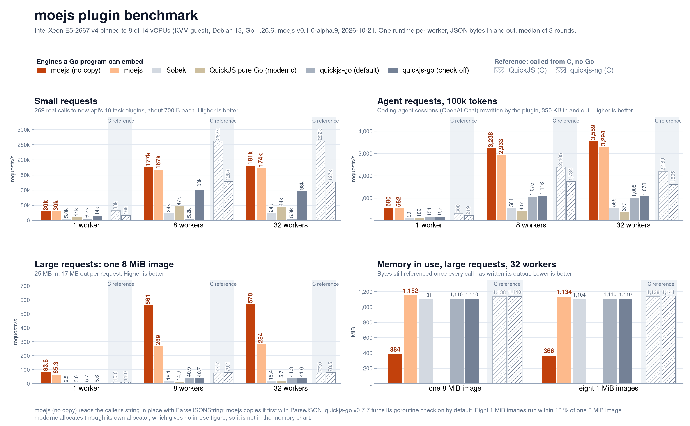
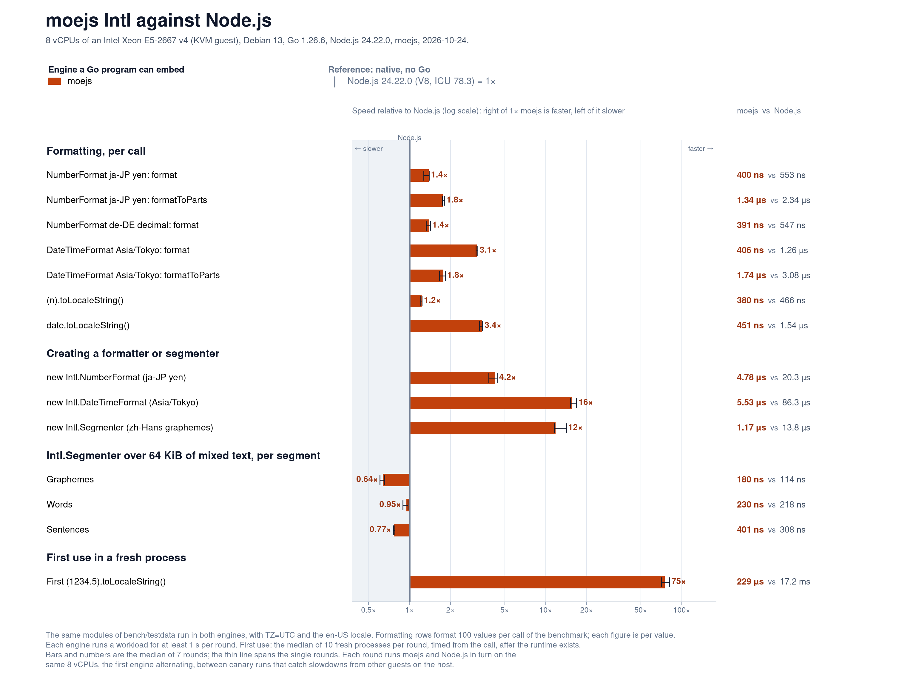

# moejs performance

How moejs compares with Sobek, QuickJS and V8 on the workload it was built
for, and how to reproduce the numbers.

[简体中文](performance.zh_CN.md)

## Setup

Unless a section says otherwise, numbers are medians of 5 runs on 2026-10-01: 13th Gen Intel Core
i5-13500H (6 performance + 6 efficiency cores, hyperthreaded to 16 logical
CPUs), Linux, go1.26.6 linux/amd64. Serial rows are pinned to 8 threads
(`taskset -c 0-7 GOMAXPROCS=8`). The machine was not idle, so treat
differences under about 10% as noise. The baselines are Sobek
`v0.0.0-20260708062710` (pure Go), modernc.org/quickjs `v0.25.0` (QuickJS
translated to pure Go, measured on 2026-10-08 on the same machine),
quickjs-go `v0.7.7` (QuickJS, cgo) and v8go `v0.9.0` (V8, cgo).

The workload is new-api's 10 task plugins (6,358 lines) and 269 hook calls
recorded on Sobek, 47 of which throw. Every measurement is taken from the Go
caller's side and includes converting the arguments and the result. The cgo
engines exchange JSON text, and a host that uses them pays for it too. Every iteration checks
the result.

## Hook calls

All 269 cases in a loop, one goroutine, mean per call:

| Engine | Time | Bytes | Allocations |
|---|--:|--:|--:|
| **moejs** | **6.86 µs** | 4.7 KB | 30 |
| Sobek | 14.32 µs | 11.1 KB | 163 |
| modernc-quickjs | 35.16 µs | 5.4 KB | 100 |
| v8go | 56.64 µs ¹ | 5.3 KB | 104 |
| quickjs-go | 104.50 µs | 7.6 KB | 118 |

¹ v8go's timings varied widely on this machine. Read them as an order of
magnitude.

A few of moejs's 30 allocations are the benchmark adapter's own: boxing the
arguments and the result into the harness's interface types.
`Runtime.Call` itself allocates nothing. The rest come from the plugins'
objects and the conversions.

## Host path

`BenchmarkHostFlow`: the same 269 calls with everything new-api's host does
around them, mean per call. With Sobek's API the host deep-copies every
argument, because Sobek wraps Go maps live, and decodes a result through
`Export`, `json.Marshal` and `json.Unmarshal` into its struct. With moejs it
passes its maps as they are and unmarshals the bytes of `AppendJSON`. The
second row starts from each argument's JSON bytes, as the host holds stored
task data (`json.Unmarshal` + `ToValue` for Sobek, `ParseJSON` for moejs):

| Arguments | moejs | Sobek |
|---|--:|--:|
| Go values | 12.92 µs / 5.1 KB / 37 allocs | 22.80 µs / 13.8 KB / 206 |
| JSON bytes | 17.45 µs / 8.4 KB / 79 | 36.30 µs / 15.0 KB / 252 |

A 10 KiB JSON-shaped host round trip (`identity(v) { return v }`, no
property reads) is 177 ns / 6 allocs in moejs against Sobek's 308 ns / 10
allocs, although Sobek's live-proxy `ToValue` pays nothing until JavaScript
reads a field.

## Runtimes

A new runtime with new-api's host globals, then evaluating a plugin module
in it. Memory is the Go heap retained per live runtime:

| | moejs | Sobek | modernc-quickjs | quickjs-go | v8go |
|---|--:|--:|--:|--:|--:|
| New runtime | 1.39 µs / 27 allocs | 2.20 µs / 47 | 179.8 µs / 87 | 381.7 µs / 135 | 1152.7 µs ¹ / 54 |
| + largest plugin (alibaba) | 71.0 µs / 479 | 321.8 µs / 4,499 | 4,326 µs ² | 3,230 µs ² | 2,493 µs ¹ ² |
| + smallest plugin (sora) | 7.0 µs / 81 | 37.6 µs / 672 | 1,124 µs ² | 1,070 µs ² | 1,349 µs ¹ ² |
| Retained, alibaba, 512 runtimes | 80.5 KiB | 263.6 KiB | 226.8 KiB ⁴ | 347.9 KiB ³ | 1,544 KiB ³ |
| Retained, sora, 64 runtimes | 11.8 KiB | 49.2 KiB | | | |

¹ v8go, see the note above. ² Includes compiling the script, which the
QuickJS engines and V8 do per context. ³ The engine's own heap (QuickJS
`malloc_size`, V8 used heap size). ⁴ How much the resident set grew per
runtime: modernc.org/quickjs allocates outside the Go heap and keeps no
in-use count. The figure also moves with memory the process freed earlier,
so the smaller plugins, measured after other runtimes were closed, are left
out.

Compiling the largest plugin takes 2.2 ms in moejs and 2.6 ms in Sobek, once
per process. With `Options{MutableIntrinsics: true}` a new runtime costs
35.9 µs and a live alibaba runtime retains 229.4 KiB.

## Micro-benchmarks

moejs vs Sobek, 100 iterations per operation:

| Case | moejs | Sobek | Speed-up | Allocations (moejs / Sobek) |
|---|--:|--:|--:|--:|
| Property read, monomorphic | 6.4 µs | 18.9 µs | 2.9x | 9 / 96 |
| Property read, polymorphic | 6.6 µs | 13.3 µs | 2.0x | 8 / 11 |
| Function call | 6.4 µs | 12.0 µs | 1.9x | 9 / 89 |
| Closure | 17.6 µs | 58.9 µs | 3.3x | 211 / 1,094 |
| Array push + for-of | 7.3 µs | 64.7 µs | 8.9x | 15 / 719 |
| String concatenation | 20.7 µs | 34.5 µs | 1.7x | 399 / 712 |
| String methods | 181 µs | 791 µs | 4.4x | 909 / 11,811 |
| `JSON.parse` | 7.3 ms | 43.3 ms | 5.9x | 66k / 807k |
| `JSON.stringify` | 4.7 ms | 14.5 ms | 3.1x | 1,415 / 237k |
| `Object.keys` + `Object.assign` | 268 µs | 777 µs | 2.9x | 609 / 17,302 |
| RegExp test + replace | 193 µs | 552 µs | 2.9x | 2,210 / 9,503 |
| `new Error` + throw + catch | 30.2 µs | 72.8 µs | 2.4x | 300 / 1,393 |

## Plugin scenarios



Throughput of new-api's plugin workloads on the engines a Go program can embed, with QuickJS called straight from C as a reference, measured on 2026-10-21 with moejs v0.1.0-alpha.9.

- Intel Xeon E5-2667 v4 (Broadwell, 3.2 GHz), a KVM guest with 14 vCPUs and 15 GB of RAM, with the benchmark pinned to 8 of the vCPUs (taskset 0-7, GOMAXPROCS=8), Debian 13, Go 1.26.6, gcc 14.2.
- One runtime per worker. A call hands JSON bytes to the engine to parse, calls the plugin, and serializes the result into bytes the host owns. Each run warms up for 2 s and measures 6 s (small and agent requests) or 8 s (large requests). Runs go back to back, the engine order changes for every cell, and every cell is the median of 3 rounds.
- Each run records the CPU time other processes in the guest used while it ran; none averaged more than a quarter of a core. Load from other guests on the host does not show up there, so every run first waited for a short probe showing the host quiet, and a run more than 5 % slower than both other rounds of its cell was repeated.
- Small requests are 269 real calls to new-api's 10 task plugins. Agent requests are 8 different coding sessions of 100k tokens each (o200k_base): a system prompt, 12 tool definitions, a user task and the results of 67 to 102 tool calls (Go source, grep hits and test output). The agent plugin was written for this benchmark against the interface of new-api's task plugin buildSubmitRequest: it converts every message, renames the model, prefixes the system prompt, drops parameters and JSON Schema keywords the upstream rejects, and returns url, headers and body. Large requests take 25 MB in and 17 MB out.
- Memory is the Go heap still live after a GC plus the bytes glibc malloc has in use, read while every worker is stopped right after its last call. It includes the 32 runtimes and leaves out garbage waiting for collection.
- quickjs-go v0.7.7 turns its goroutine check on by default, which reads a goroutine stack on every API call; the charts show both settings. Both serialize with JSON.stringify, because Value.JSONStringify leaks. Sobek is the 2026-07-08 version.
- modernc.org/quickjs v0.25.0 is QuickJS translated to pure Go by the modernc toolchain, with no cgo. It has no JSON API, so the argument goes in as text that JSON.parse reads inside the engine, and JSON.stringify writes the result. It allocates through its own allocator, which gives no in-use figure, so it has no memory number.
- The C hosts are built with gcc 14.2: QuickJS 2026-06-04 with -O2, quickjs-ng 0.15.1 (the copy shipped in quickjs-go) with -O3.
- ParseJSONString reads the caller's string in place, so the caller must not change those bytes while the call's values are in use.

Requests per second, median of 3 rounds:

| Scenario | Workers | moejs (no copy) | moejs | Sobek | QuickJS pure Go (modernc) | quickjs-go (default) | quickjs-go (check off) | QuickJS (C) | quickjs-ng (C) |
|---|--:|--:|--:|--:|--:|--:|--:|--:|--:|
| Small requests | 1 | 30,073 | 29,720 | 4,983 | 10,519 | 6,243 | 14,428 | 32,912 | 15,965 |
| Small requests | 8 | 176,507 | 167,400 | 24,047 | 46,701 | 5,160 | 99,633 | 262,285 | 127,922 |
| Small requests | 32 | 180,656 | 173,501 | 24,077 | 44,074 | 5,304 | 98,157 | 262,340 | 127,314 |
| Agent requests, 100k tokens | 1 | 580 | 562 | 99 | 109 | 154 | 157 | 300 | 219 |
| Agent requests, 100k tokens | 8 | 3,238 | 2,933 | 564 | 407 | 1,075 | 1,116 | 2,405 | 1,734 |
| Agent requests, 100k tokens | 32 | 3,559 | 3,294 | 565 | 377 | 1,005 | 1,078 | 2,189 | 1,605 |
| One 8 MiB image | 1 | 83.6 | 65.3 | 2.5 | 3.0 | 5.7 | 5.6 | 10.0 | 11.0 |
| One 8 MiB image | 8 | 561 | 269 | 18.1 | 14.9 | 40.9 | 40.7 | 77.7 | 79.1 |
| One 8 MiB image | 32 | 570 | 284 | 18.4 | 15.7 | 41.3 | 41.0 | 77.0 | 78.5 |
| Eight 1 MiB images | 1 | 83.6 | 65.2 | 2.6 | 2.9 | 5.7 | 5.7 | 10.0 | 9.6 |
| Eight 1 MiB images | 8 | 546 | 268 | 19.0 | 14.9 | 40.9 | 41.0 | 77.5 | 72.9 |
| Eight 1 MiB images | 32 | 565 | 282 | 19.9 | 14.0 | 41.2 | 40.7 | 76.2 | 78.9 |

Memory in use at 32 workers, MiB (modernc has no in-use figure):

| Scenario | moejs (no copy) | moejs | Sobek | QuickJS pure Go (modernc) | quickjs-go (default) | quickjs-go (check off) | QuickJS (C) | quickjs-ng (C) |
|---|--:|--:|--:|--:|--:|--:|--:|--:|
| One 8 MiB image | 384 | 1,152 | 1,101 | — | 1,110 | 1,110 | 1,138 | 1,140 |
| Eight 1 MiB images | 366 | 1,134 | 1,104 | — | 1,110 | 1,110 | 1,138 | 1,141 |

## Intl



Intl against Node.js 24.22 (V8, ICU 78.3), measured on 2026-10-24 with Go 1.26.6 on the machine of the plugin scenarios, pinned to the same 8 vCPUs. Both engines run the same modules of `bench/testdata` with TZ=UTC and the en-US locale: BenchmarkIntlFormat and BenchmarkIntlSegmenter for moejs, `bench/scripts/intl_format_node.mjs` and `intl_node.mjs` for Node.js. Every figure is the median of 7 rounds. A round runs moejs and Node.js in turn, the first engine alternating, between canary runs that catch load from other guests on the host.

moejs formats 1.2 to 3.4 times as fast as Node.js and creates a formatter 4 to 16 times as fast. Intl.Segmenter is slower than Node.js per segment, at 0.64x on graphemes, 0.95x on words and 0.77x on sentences.

Time per call, median of 7 rounds. Speed is Node.js's time over moejs's:

| Case | moejs | Node.js | Speed |
|---|--:|--:|--:|
| NumberFormat ja-JP yen, format | 400 ns | 553 ns | 1.4x |
| NumberFormat ja-JP yen, formatToParts | 1.34 µs | 2.34 µs | 1.8x |
| NumberFormat de-DE decimal, format | 391 ns | 547 ns | 1.4x |
| DateTimeFormat Asia/Tokyo, format | 406 ns | 1.26 µs | 3.1x |
| DateTimeFormat Asia/Tokyo, formatToParts | 1.74 µs | 3.08 µs | 1.8x |
| `(n).toLocaleString()` | 380 ns | 466 ns | 1.2x |
| `date.toLocaleString()` | 451 ns | 1.54 µs | 3.4x |
| `new Intl.NumberFormat` | 4.78 µs | 20.3 µs | 4.2x |
| `new Intl.DateTimeFormat` | 5.53 µs | 86.3 µs | 16x |
| `new Intl.Segmenter` | 1.17 µs | 13.8 µs | 12x |
| Segmenter, per grapheme | 180 ns | 114 ns | 0.64x |
| Segmenter, per word | 230 ns | 218 ns | 0.95x |
| Segmenter, per sentence | 401 ns | 308 ns | 0.77x |
| First `toLocaleString` in a fresh process | 229 µs | 17.2 ms | 75x |

The same rounds measured the Web API chart in the README, with `bench/cmd/webapibench`. `bench/scripts/intl_webapi_bench.sh` builds the benchmarks and runs new rounds, and `uv run --with matplotlib bench/scripts/intl_webapi_chart.py` redraws both charts from `docs/assets/intl-webapi-bench.jsonl` (`--table` prints the numbers).

## Another machine

hanxi measured these numbers for [#1](https://github.com/Calcium-Ion/moejs/pull/1), which added modernc.org/quickjs to
the benchmarks: Intel Xeon E5-2650 v3 (2 × 10 cores, hyperthreaded to 40
logical CPUs), Linux, go1.26.0 linux/amd64, medians of 3 runs on 2026-10-08.
quickjs-go ran with its default settings, and V8 was not run.

| | moejs | Sobek | modernc-quickjs | quickjs-go |
|---|--:|--:|--:|--:|
| One plugin call | 21.4 µs / 4.8 KB / 29 | 45.8 µs / 11.3 KB / 163 | 111.6 µs / 5.4 KB / 100 | 316 µs / 7.8 KB / 118 |
| New runtime | 4.27 µs | 6.17 µs | 556 µs | 1,126 µs |
| + largest plugin (alibaba) | 247 µs | 931 µs | 10,666 µs | 7,530 µs |
| + smallest plugin (sora) | 22.2 µs | 111 µs | 2,944 µs | 2,694 µs |
| Retained, alibaba, 512 runtimes | 75.7 KiB | 264.2 KiB | 456 KiB ¹ | 347.9 KiB ² |

¹ How much the resident set grew. ² The engine's own heap.

## Reproducing

The benchmarks live in `bench/` and run new-api's plugins, which
`bench/testdata/plugins/fetch.sh` downloads at a pinned commit:

```sh
bench/testdata/plugins/fetch.sh
cd bench
go test -run xxx -bench 'Benchmark(HookSuite|HostFlow|NewRuntime|Instantiate|Compile|Micro)$' -benchmem -count 5 .
go test -run TestFootprint -v .
```

`bench/scripts/run_all.sh` runs the full set, including the parallel
throughput and per-phase benchmarks.

## PGO

`default.pgo` is recorded from the whole hook workload (`go run ./cmd/pgo`
in `bench/` regenerates it). Go applies a `default.pgo` automatically only
in the main package's directory, so an embedding program passes
`-pgo=<path to moejs>/default.pgo` or copies the profile into its own main
package.
